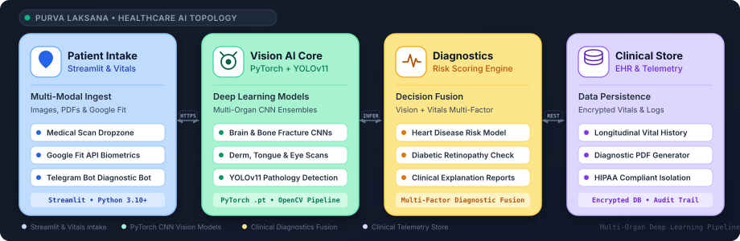

<div align="center">


<br/>

<a href="#system-architecture">
  
</a>
&nbsp;
<a href="#system-architecture">
  
</a>
&nbsp;
<a href="#system-architecture">
  
</a>
&nbsp;
<a href="#system-architecture">
  
</a>
&nbsp;
<a href="#system-architecture">
  
</a>

</div>

<br/>

# Purva Laksana — AI Healthcare Companion

An AI-powered healthcare diagnostic companion and vital tracking platform built with Streamlit, PyTorch, and OpenCV, designed to support clinical decision-making in resource-constrained environments.

Purva Laksana integrates **10+ deep learning vision models** (musculoskeletal fractures, brain MRI tumors, lung cancer nodules, diabetic retinopathy, dermatology lesions, and tongue/nail analysis) with longitudinal wearable biometrics via the **Google Fit API** and an automated **Telegram Diagnostic Bot**.

---

## Live Demo & Resources

- **Live Web Application:** [https://purvalaksana.streamlit.app](https://purvalaksana.streamlit.app)
- **Video Walkthrough:** [Watch Video Demo](https://drive.google.com/file/d/1Oe_IghfVzKBcsAsn4oUIKT7QeNrnXotM/view?usp=share_link)
- **Presentation Deck:** [View PPT Slides](https://docs.google.com/presentation/d/1rUj-osOSw9LMpuM4ypk2f_lFPd-FrmKU/edit?usp=sharing)

---

## System Architecture

<p align="center" style="margin: 20px 0;">
  
</p>

* **Patient Intake (Streamlit & Vitals)**: Multi-modal scan dropzone, Google Fit API biometric integration, and Telegram bot diagnostic triage.
* **Vision AI Core (PyTorch + YOLOv11)**: Multi-organ deep learning ensembles for brain MRI, bone fractures, skin lesions, and retinal scans.
* **Diagnostics (Risk Scoring Engine)**: Multi-factor decision fusion combining computer vision models with real-time vitals and clinical explanation reports.
* **Clinical Store (EHR & Telemetry)**: Encrypted longitudinal vitals persistence, automated PDF report generation, and HIPAA-compliant data isolation.

---

## Deep Learning Diagnostic Models

| Anatomical Domain | Model File | Modality | Clinical Target |
| :-- | :-- | :-- | :-- |
| **Orthopedics** | `bone.pt` | Musculoskeletal X-Ray | Fracture & dislocation localization |
| **Neurology** | `braintumorp1.pt` & `brain123.pt` | Intracranial MRI | Tumor detection & lesion segmentation |
| **Pulmonology** | `lung_cancer.pt` | Chest Radiograph | Pulmonary nodule & malignancy indicators |
| **Ophthalmology** | `diabetic.pt` & `eye.pt` | Retinal Fundus Photo | Diabetic retinopathy grading & microaneurysms |
| **Dermatology** | `skin345.pt` & `ulcer.pt` | Dermoscopic Scan | Melanoma, keratosis, and diabetic foot ulcers |
| **General Pathology** | `tongue(2).pt` & `nails.pt`| Visible Light Photography | Nutritional deficiencies & systemic signs |
| **Object Detection** | `yolo11n.pt` | Multi-Modal Visual Feed | High-speed bounding box anomaly detection |

---

## Engineering Documentation

The project includes a complete production-grade architecture and development documentation suite:

| Document | Purpose |
| :-- | :-- |
| [**`docs/PRD.md`**](./docs/PRD.md) | Product Requirements Document: MVP specifications, target personas & success metrics |
| [**`docs/ARCHITECTURE.md`**](./docs/ARCHITECTURE.md) | System topology, deep learning vision pipeline, directory tree & ADRs |
| [**`docs/RULES.md`**](./docs/RULES.md) | Engineering standards, PyTorch conventions, and patient privacy guardrails |
| [**`docs/DESIGN.md`**](./docs/DESIGN.md) | Design system, UI tokens, Inter & JetBrains Mono typography, and telemetry cards |
| [**`docs/TASKS.md`**](./docs/TASKS.md) | Phased roadmap tracking 24 engineering deliverables with priority & status badges |
| [**`docs/MEMORY.md`**](./docs/MEMORY.md) | Active session memory, completed milestone log, and operational boundaries |

---

## Setup Instructions

### Prerequisites
- Python `3.10+` (Python `3.11` recommended)
- Git & Virtualenv

### 1. Clone the repository
```bash
git clone https://github.com/abhishek4643/PurvaLaksana.git
cd PurvaLaksana
```

### 2. Environment Setup
```bash
python -m venv .venv
source .venv/bin/activate  # On Windows: .venv\Scripts\activate
pip install -r requirements.txt
```

### 3. Launch Streamlit Application
```bash
streamlit run login.py
```
Open [http://localhost:8501](http://localhost:8501) with your browser.

### 4. Launch Telegram Triage Bot (Optional)
```bash
python telegram_bot.py
```

---

## Clinical Disclaimer

> **IMPORTANT**: Purva Laksana is an AI-assisted preliminary triage tool intended for educational, research, and assistive screening purposes. It is NOT a certified replacement for professional medical diagnosis or clinical consultation. Always consult a licensed healthcare practitioner for medical decisions.

---

## License

This project is licensed under the MIT License.
