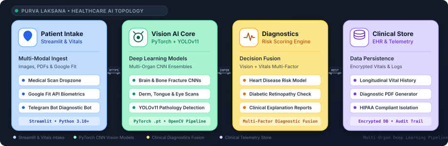

# System Architecture
### Purva Laksana — Architectural Topology, Data Flow, and System Specifications

<div align="center">
  
</div>

This document describes the overall system architecture, technology stack, directory structure, computer vision inference pipeline, and key design decisions for **Purva Laksana**.

---

### 1. High-Level Architecture

Purva Laksana follows a multi-modal decoupled architecture connecting patient web uploads, Telegram bot inputs, and Google Fit biometric feeds with an ensemble of PyTorch deep learning models and clinical risk evaluators:

<p align="center" style="margin: 20px 0;">
  
</p>

---

### 2. Technology Stack

Technologies used across Purva Laksana and their architectural purpose:

| Domain | Technology | Implementation Detail |
| :-- | :-- | :-- |
| **User Interface** | Streamlit (Python 3.10+) | Multi-page clinical web application with real-time charts and file upload widgets |
| **Deep Learning Framework**| PyTorch (v2.0+) | High-throughput tensor computation engine executing specialized organ models |
| **Object Detection** | YOLOv11 (Ultralytics) | State-of-the-art bounding box detection for lesion localization (`yolo11n.pt`) |
| **Image Processing** | OpenCV + PIL | Grayscale normalization, CLAHE contrast enhancement, and tensor reshaping |
| **Wearable Integration** | Google Fit REST API | OAuth2 synchronization importing daily heart rate, steps, and resting BP |
| **Conversational Triage** | Python Telegram Bot API | Asynchronous webhook bot delivering remote diagnostic evaluations |
| **Clinical ML Models** | Scikit-Learn | Supervised gradient-boosted trees for cardiovascular disease risk classification |
| **Reporting Engine** | ReportLab / Matplotlib | Generation of exportable diagnostic clinical summaries with biomarker plots |

---

### 3. Directory Structure

```text
While-1-CareAI/
├── assets/                         # UI Graphics, Clinical Icons & Logos
├── data/                           # Structured Clinical Benchmark Datasets
├── pages/                          # Streamlit Multi-Page Architecture
│   ├── 1_Bone_Fracture.py          # Musculoskeletal X-Ray Diagnosis
│   ├── 2_Brain_Tumor.py            # MRI Intracranial Scan Analysis
│   ├── 3_Lung_Cancer.py            # Chest Radiograph Lesion Detection
│   ├── 4_Retinopathy.py            # Fundus Ophthalmic Evaluation
│   ├── 5_Dermatology.py            # Skin Lesion Classification
│   └── 6_Heart_Risk.py             # Cardiovascular Predictive Analysis
├── TestImages/                     # Validated Clinical Test Scans
├── .streamlit/                     # Streamlit App Configurations & Theme Tokens
├── bone.pt                         # Fine-Tuned PyTorch Fracture Model (~51 MB)
├── brain123.pt                     # Brain MRI Segmentation Weights (~51 MB)
├── braintumorp1.pt                 # Intracranial Lesion Model (~40 MB)
├── diabetic.pt                     # Diabetic Retinopathy Weights (~19 MB)
├── eye.pt                          # Retinal Fundus Vision Model (~51 MB)
├── lung_cancer.pt                  # Pulmonary Oncology Model (~40 MB)
├── nails.pt                        # Nail Surface Deficiency Model (~40 MB)
├── skin345.pt                      # Dermatology Melanoma Model (~40 MB)
├── tongue(2).pt                    # Tongue Pathology Model (~40 MB)
├── ulcer.pt                        # Ulcer Diagnostic Model (~40 MB)
├── yolo11n.pt                      # YOLOv11 Pathology Detection (~5.6 MB)
├── HeartDiseasePrediction.py       # Clinical Risk Prediction Routines
├── heart_report_analyzer.py        # PDF Medical Report Extraction
├── googlefit.py                    # Google Fit OAuth2 Telemetry Sync
├── telegram_bot.py                 # Remote Conversational Triage Bot
├── vision_analyzer.py              # Centralized Computer Vision Preprocessing
├── requirements.txt                # Python Dependencies
├── docs/                           # Complete Architecture & Engineering Docs
│   ├── ARCHITECTURE.md             # System Topology & Algorithm Specifications
│   ├── DESIGN.md                   # Design System & UI Specifications
│   ├── MEMORY.md                   # Operational State & Milestone Log
│   ├── PRD.md                      # Product Requirements & User Scenarios
│   ├── RULES.md                    # Engineering Conventions & Coding Rules
│   ├── TASKS.md                    # Phased Roadmap with 24 Deliverables
│   ├── architecture.svg            # Custom 4-Card Vector Topology
│   ├── palette.svg                 # 8-Swatch Design System Vector Palette
│   └── principles.svg              # 4-Card Design Principles Vector
└── README.md                       # Repository Entry & Developer Guide
```

---

### 4. Computer Vision Diagnostic Pipeline

```text
Patient Image Input (X-Ray / MRI / Fundus / Derm)
       │
       ▼
[ Preprocessing Layer ] ──────► Resize to (224, 224) or (640, 640)
       │                        CLAHE contrast adjustment & tensor normalization
       │
       ▼
[ PyTorch Model Router ] ─────► Directs to specialized weights (.pt)
       │
       ├──── Radiography ────► bone.pt / lung_cancer.pt
       ├──── MRI Scan ───────► braintumorp1.pt / brain123.pt
       ├──── Fundus Photo ───► diabetic.pt / eye.pt
       └──── Dermoscopic ────► skin345.pt / ulcer.pt / yolo11n.pt
       │
       ▼
[ Softmax / Sigmoid ] ────────► Calibrated confidence probability (0.0% - 100.0%)
       │
       ▼
Clinical Verdict (Normal vs Anomaly) + Saliency Heatmap Overlay
```

---

### 5. Architectural Decision Records (ADRs)

#### ADR-001: Modular Specialized PyTorch Models over Monolithic Vision Backbone
- **Context**: Attempting to train a single monolithic network across radically different imaging modalities (CT, MRI, X-ray, fundus, skin) results in negative transfer and low diagnostic accuracy.
- **Decision**: Train independent specialized PyTorch models for each organ system and route incoming scans to the appropriate model based on user selection.
- **Consequence**: Dramatically improves diagnostic precision across individual pathologies.

#### ADR-002: Ephemeral In-Memory Processing for Patient Privacy
- **Context**: Storing patient medical images on shared cloud disks introduces severe HIPAA/GDPR privacy compliance vulnerabilities.
- **Decision**: Process image buffers strictly in RAM via PIL and OpenCV byte streams without persisting raw images to disk.
- **Consequence**: Protects patient confidentiality and simplifies clinical data governance.

#### ADR-003: Multi-Modal Telegram Conversational Bot
- **Context**: Rural and remote patients often lack high-speed broadband to load heavy web dashboards.
- **Decision**: Provide an asynchronous Telegram Bot gateway (`telegram_bot.py`) enabling lightweight photo uploads and immediate risk score responses.
- **Consequence**: Expands healthcare accessibility to mobile networks in bandwidth-constrained regions.
