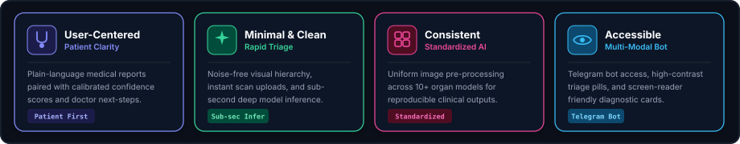
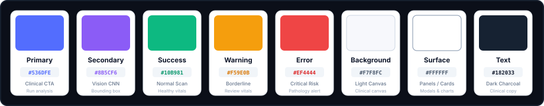

# Design System
### Purva Laksana — Clean. Simple. Productive.

  

This document defines the visual design system, UI components, design tokens, and clinical user experience standards for the **Purva Laksana** multi-organ healthcare diagnostic platform. The goal is to establish an authoritative, clear, and calming clinical interface across medical imaging viewers, biometric telemetry widgets, and risk reports.

---

### 1. Design Principles

  

---

### 2. Color Palette
*Primary colors used across the clinical interface, diagnostic models, and vital tracking dashboards:*

  

---

### 3. Typography
*We use Inter as the primary interface font and JetBrains Mono for diagnostic confidence scores and biometric telemetry:*

  <table width="100%" cellpadding="0" cellspacing="0" border="0">
    <tr>
      <td width="90" align="center" style="font-size: 40px; font-weight: 800; background-color: #161B22; color: #818CF8; border: 1px solid #30363D; border-radius: 8px; padding: 8px 12px;">Aa</td>
      <td style="padding-left: 20px;">
        
Inter &amp; JetBrains Mono

        
Primary clinical font family

        
Clean, modern, and highly legible across clinical summaries, biomarker tables, and diagnostic scans.

      </td>
    </tr>
  </table>

| Role | Font Family | Size / Weight | Usage |
| :-- | :-- | :-- | :-- |
| **Clinical Title** | Inter | 24px / 700 Bold | Streamlit main page headers |
| **Section Header** | Inter | 18px / 600 Semi-Bold | Organ diagnostic module titles |
| **Body Regular** | Inter | 14px / 400 Regular | Clinical guidance, findings, and explanations |
| **Biometric Mono** | JetBrains Mono | 12px / 600 Semi-Bold | Heart rate (BPM), blood pressure (mmHg), confidence (%) |

---

### 4. UI Components & Visual Tokens

#### 4.1 Diagnostic Triage Status Badges

| Classification | Background | Text Color | Border | Meaning |
| :-- | :-- | :-- | :-- | :-- |
| **NORMAL / LOW RISK** | `#ECFDF5` | `#059669` | `1px solid #A7F3D0` | Scan exhibits no detectable pathology ($\ge 90\%$ healthy) |
| **BORDERLINE / REVIEW** | `#FFFBEB` | `#D97706` | `1px solid #FDE68A` | Ambiguous features; secondary physician review advised |
| **HIGH RISK ANOMALY** | `#FEF2F2` | `#DC2626` | `1px solid #FECACA` | High-confidence pathological lesion detected |

#### 4.2 Biometric Telemetry Card

  

    

      Live Biometrics &bull; Google Fit
      
Resting Heart Rate: 72 BPM

    

    

      CARDIAC STATUS: OPTIMAL
      
BP: <code style="color: #818CF8;">120/80 mmHg</code> &bull; Synced 2m ago

    

  

